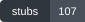
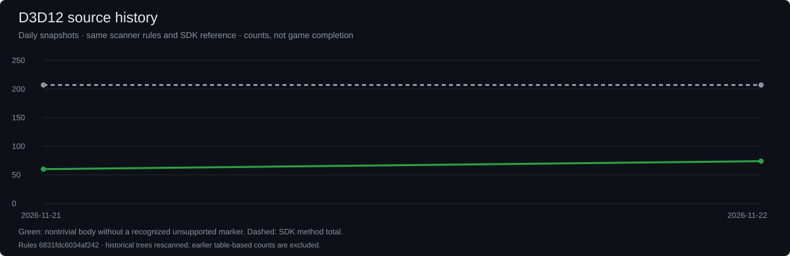

# Leonida source tracker

[](https://github.com/omdev74/leonida-progress/actions/workflows/refresh.yml)
[](data/report.md)
[](data/report.md)
[](data/report.md)
[](data/report.md)
[](https://github.com/omdev74/leonida-progress/actions/workflows/refresh.yml)

[](data/report.md)

[](data/history.md)

An independent tracker for [ItsNotRexed/Leonida](https://github.com/ItsNotRexed/Leonida), inspired by the treemap graphics in Xbox2Windows and AnyPS5. **The primary panel scans the C++ source on `main` directly. It does not depend on someone updating a method-coverage table.** The contribution queue remains optional human coordination context.

This measures the D3D12 implementation surface currently recognized by the scanner. It does not measure overall game completion, GPU correctness, playable games, or every subsystem in Leonida.

[Named methods and source links](data/report.md) · [History table](data/history.md) · [Snapshot JSON](data/progress.json) · [History JSON](data/history.json)

## How the source scan works

1. Fetch Leonida's public `main` into a local bare Git cache. Pin one commit for the entire measurement. No upstream code, hooks, build scripts, game files, or submodules are executed.
2. Read production `.cpp`, `.h`, and `.hpp` files under `runtime/shims` and `runtime/src`, excluding `test`, `tests`, `generated`, and `third_party` directories.
3. Discover the D3D12 interface set from the `gen_d3d12_stubs.py` command in `runtime/CMakeLists.txt`. Derive each interface's method denominator from a **commit-pinned, SHA-256-checked Microsoft DirectX header**, including its inheritance chain and excluding `IUnknown`.
4. Parse C++ with the pinned Tree-sitter C++ grammar. Identify concrete generated-stub classes, their `Object`/`Child` shared bases, inline bodies, and out-of-line definitions. Class and method ownership prevents unrelated functions with the same name from being counted.
5. Classify every named method and publish its source link at the exact scanned commit. The standalone SVG has method tooltips and links when opened directly; the README image links to the full evidence table.

| Color | Classification | Meaning |
|---|---|---|
| Green | Body present | Nontrivial definition without a recognized unsupported marker |
| Amber | Partial / unsupported | Body or a recognized local helper reaches an explicit unsupported marker |
| Blue | No-op / constant | Empty or simple constant-return body; may be intentional |
| Grey | Stub / missing | Inherited generated fallback, or an explicit unsupported/logging-only body |

Recognized unsupported markers include calls to `stub`, `note_once`, `not_implemented`, and `unimplemented`, and the `E_NOTIMPL` identifier. Comments and string literals do not count as code. Markers propagate through recognized helpers in the same class and free functions in the same file; matching overloaded helpers are treated conservatively. The scanner does not prove runtime reachability or resolve arbitrary cross-file calls, virtual dispatch, macros, or C++ build configurations. A green cell is **not proof of complete or correct API behavior**.

Each interface gets an area proportional to its method count. Each method gets one square, including inherited methods within each interface. SDK alternative ABI declarations are deduplicated by method name. New interfaces added to the recognized generator command expand the inventory automatically when supported by the pinned reference. A new interface absent from that reference requires a reviewed reference update.

Unknown generator structures, unsupported inheritance wrappers, ambiguous definitions, conditional compilation in measured classes, parse errors in measured classes, unknown SDK overrides, and invalid denominators stop the refresh. The scanner prefers a visible failed refresh to guessed coverage. Only the published metadata and aggregate evidence leave the Git cache; raw source bodies and the SDK header are not committed here.

## History and badges

The chart compares **nontrivial body count** with the **known method total**. It keeps one latest observed point per UTC day and shows regressions as decreases. Initial history is backfilled from the last first-parent `main` commit in each available UTC day over the previous 14 days, using the same scanner and pinned reference as today's measurement. Historical trees that cannot be scanned are listed as unmeasured, not recorded as zero.

This source-based series starts separately from the old coordinator-table tracker. Old table counts are never relabeled as source measurements. Changes to scanner rules or the SDK reference start a separate history series; previous series stay in `history.json` and are not joined into a misleading line. Each history point links to its source commit.

Badges expose method bodies, partial paths, stubs, the scanned revision, and the last successful check. The workflow badge exposes refresh failures. Read the timestamp before relying on an image that GitHub may have cached.

## Automatic operation

The workflow runs **hourly at minute 23 UTC**, on relevant changes to this tracker, and via the **Run workflow** button. Each successful run fetches the latest upstream `main`, rescans it, updates the history, redraws the SVGs and badges, and commits the output. New commits, recognized interfaces, task IDs, and task prefixes need no manual count edits. The treemap recalculates its layout and grows vertically as needed.

This runs unattended while GitHub Actions remains enabled and the source uses supported patterns. Maintainers do not need to update coordinator method totals. An incompatible refactor, new code-generation scheme, unavailable pinned reference, network failure, disabled Actions, or changed permissions can require maintenance. A failed source scan preserves the previous published outputs and their timestamp. The workflow publishes nothing from an unsuccessful process.

Scheduled runs are best effort and can be delayed by GitHub. Public repository schedules may be disabled after 60 days without repository activity; successful refresh commits keep this repository active. [GitHub scheduling documentation](https://docs.github.com/en/actions/reference/workflows-and-actions/events-that-trigger-workflows#schedule).

## Contribution context

The second panel reads listed task IDs from [#313](https://github.com/ItsNotRexed/Leonida/issues/313) and the current open issue titled “Coordinating who works on what.” That general coordination issue is discovered again after a thread rollover. Amber means active/claimed, grey available, red explicitly blocked, and blue unclear. Repeated IDs count once, with blocked taking precedence over active and active over available. Active includes pending PRs and does not imply passing CI.

This optional panel is the current list, not every remaining task or a lifetime completion ledger. Tasks disappearing from the tables are not assumed complete. Prose-only tasks outside the explicit blocked summary are not counted. Table updates depend on the coordinator, and issue update timestamps include comments. If coordination data becomes unavailable, the source scan still publishes, with an explicit queue-unavailable note instead of invented zero task counts. #313's successor must be configured if that issue closes.

## Embed it in a README

```markdown
[](https://github.com/omdev74/leonida-progress/blob/main/data/report.md)
[](https://github.com/omdev74/leonida-progress/actions/workflows/refresh.yml)

[](https://github.com/omdev74/leonida-progress)

[](https://github.com/omdev74/leonida-progress/blob/main/data/history.md)

Automatically scanned from upstream source. Body presence, not verified correctness or game completion; [counting rules and evidence](https://github.com/omdev74/leonida-progress/blob/main/data/report.md).
```

The URLs follow this tracker's `main`, so the images update without repeated commits in the consuming repository. GitHub image caching may add delay. The tracker is useful independently now; showing it on Leonida's front page requires the maintainers to merge [the README integration PR](https://github.com/ItsNotRexed/Leonida/pull/762) and accept the external image dependency.

## Run and maintain

Python 3.12+, Git, and two pinned C++ parser packages:

```sh
python -m pip install -r requirements.txt
python -I -W error -m unittest discover -s tests -v
python -I progress.py
```

`python -I progress.py --gh-cli` uses an authenticated local GitHub CLI for optional coordination requests. Direct requests use `GH_TOKEN` or `GITHUB_TOKEN` when set. GitHub Actions supplies its repository token, so scheduled updates require no personal token. The source Git repository and SDK reference are cached under `.cache/`; they are never executed or published. Fork PRs run read-only tests; only this repository's refresh job can commit generated files.

`tracker.json` identifies upstream, the tracker repository, the coordination sources, and the pinned SDK reference. SDK updates require reviewing the new reference, updating its revision and checksum, and rerunning tests. New source patterns belong in `source_scan.py` with synthetic regression fixtures. New kinds of progress data need their own adapter. If you fork this tracker, update the workflow repository guard and README URLs as well.

The graph and badges use an original SVG renderer. Tree-sitter is used for **C++ parsing**, not chart rendering. No charting service or runtime dashboard server is required. No code has been copied from AnyPS5.

## License

[MIT](LICENSE). Independent and unaffiliated with Leonida's maintainers, Rockstar Games, Take-Two, Microsoft, or AMD.
