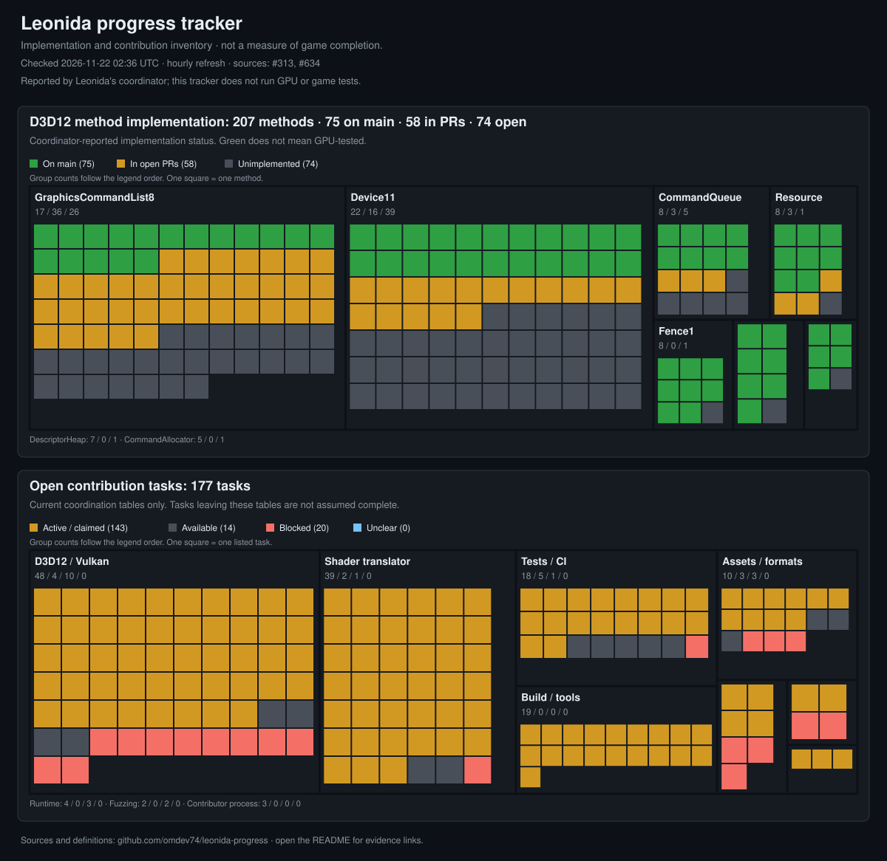

# Leonida progress tracker

[](https://github.com/omdev74/leonida-progress/actions/workflows/refresh.yml)

[](data/report.md)

An independent tracker for [ItsNotRexed/Leonida](https://github.com/ItsNotRexed/Leonida), inspired by Xbox2Windows's coverage graphic. **This is an implementation and contribution inventory, not a game-completion percentage.** It does not run the game, GPU tests, or upstream code.

## What the squares mean

The **D3D12 panel** follows the method-coverage table in [Leonida #313](https://github.com/ItsNotRexed/Leonida/issues/313). Each square is one method; category area follows the total method count. Green means reported on `main`, amber means reported in open PRs, and grey means reported unimplemented. An implementation is not proof of correct behavior. Counts come from the coordinator's table, not an independent C++ scan. Individual method names are not present in that source table, so method squares represent counts rather than named methods.

The **contribution panel** inventories task IDs in #313 and the current open issue titled “Coordinating who works on what.” Amber means claimed/active, grey means available, red means explicitly blocked, and blue means unclear. Active includes PRs awaiting review, and does not mean passing CI. Duplicate task IDs count once; blocked takes precedence over active, which takes precedence over available. This is the current set of listed tasks, not all work remaining in the project. A task disappearing from the tables is not automatically marked complete. Prose-only tasks outside the explicit blocked summary are not counted.

[Read the accessible tables and source links](data/report.md) · [Download the machine-readable snapshot](data/progress.json) · [See changes over time](https://github.com/omdev74/leonida-progress/commits/main/data/progress.json)

## Automatic updates and expansion

GitHub Actions refreshes this tracker **hourly, at minute 23 UTC**, and on relevant source changes here. There is also a **Run workflow** button in Actions. A scheduled time is best effort: GitHub may delay scheduled runs. Each successful refresh commits a new dated snapshot. Check the timestamp in the graphic and the workflow badge before relying on it.

New interfaces in the method table, new task IDs, and new task prefixes are included automatically. The treemap is recalculated and the image grows vertically when needed. The coordinator's issue number is discovered automatically when the general coordination thread rolls over. #313 remains configured explicitly; if it closes, its successor must be set in `tracker.json`. Entirely new kinds of evidence need a new adapter; the tracker does not invent project goals or estimate completion from commit counts.

If a request fails, a source closes, a table changes incompatibly, or counts do not add up, the workflow fails and **keeps the previous published snapshot**. Failures appear in Actions; an old image must not be mistaken for a fresh measurement. The issue's `updated_at` timestamp includes comments and is not evidence that the tables were just reconciled. Coordinator reconciliation and GitHub's image cache can introduce additional delay.

Public repository schedules can be disabled by GitHub after 60 days without repository activity; these hourly snapshot commits provide activity while refreshes succeed. If the job has stopped, check Actions and re-enable it. [GitHub's scheduling documentation](https://docs.github.com/en/actions/reference/workflows-and-actions/events-that-trigger-workflows#schedule).

## Put the updating graphic in a README

Paste this near the top of a README, immediately before its status section:

```markdown
[](https://github.com/omdev74/leonida-progress)

Automatically refreshed from Leonida's public coordination tables. Implementation status, not game completion; [sources and definitions](https://github.com/omdev74/leonida-progress/blob/main/data/report.md).
```

That URL follows `main`, so the image updates without repeated commits to the consuming repository. GitHub may cache the rendered image briefly. A README integration PR is subject to Leonida's maintainers accepting both the placement and the external tracker dependency. The tracker is useful on its own immediately; appearing on Leonida's front page requires that PR to be merged.

## Run or adapt it

Python 3.12+, standard library only:

```sh
python -I -m unittest discover -s tests -v
python -I progress.py
```

For a local authenticated GitHub CLI session use `python -I progress.py --gh-cli`. Direct requests use `GH_TOKEN` or `GITHUB_TOKEN` when set; GitHub Actions supplies its own token. No personal token is required for the scheduled workflow. Only the refresh job can write this tracker repository; pull-request tests have read-only permissions. No upstream files are modified by a refresh.

Edit `tracker.json` to choose a source repository and method issue. If you fork this tracker, also change the repository guard in `.github/workflows/refresh.yml` and the README URLs. Sources must use the supported table schema. New adapters can add panels to `progress.py`; add synthetic tests for their parsing and state definitions first.

Published data consists of aggregate counts, task IDs, source links, and timestamps. No game files, shaders, extracted assets, or raw issue bodies are downloaded into this repository. The implementation is original, uses Python's standard library, and has no image-generation service or hosted dashboard dependency.

## License

[MIT](LICENSE). Independent and unaffiliated with Leonida's maintainers, Rockstar Games, Take-Two, Microsoft, or AMD.
